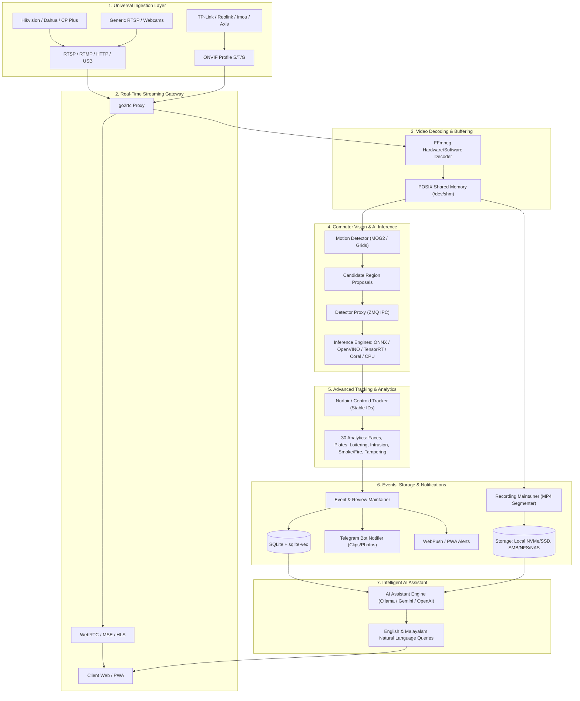

# DC VOLTAGE AI NVR — System Architecture & Engineering Report
**Product:** DC VOLTAGE AI NVR  
**Developer:** DC VOLTAGE NETWORK  
**Tagline:** Intelligent Surveillance. Zero Blind Spots.  
**Architecture Baseline:** Frigate 0.18.2 Platform Core  
**Document Version:** 1.0.0 (Production Blueprint)  

---

## 1. System Architecture Overview

DC VOLTAGE AI NVR is engineered as a high-throughput, low-latency, hybrid computer vision surveillance operating system. It marries real-time C/C++ video decoding primitives (FFmpeg, go2rtc, libva) with a Python multiprocessing coordination layer and a modern React/TypeScript dashboard.



---

## 2. Ingestion & Stream Management Pipeline

### 2.1 Multi-Protocol Camera Support
DC VOLTAGE AI NVR accommodates universal video streams through standards-compliant protocol adapters:
- **RTSP / RTP / RTCP:** Interleaved TCP/UDP streaming for high reliability over lossy local networks.
- **ONVIF Core Specifications (Profiles S, T, G):**
  - **Discovery:** WS-Discovery probing (`239.255.255.250:3702`) to identify cameras on subnet broadcasts.
  - **Profile Detection:** Dynamic extraction of stream URIs (`GetStreamUri`), resolutions, frame rates, and encoding standards (H.264, H.265, MJPEG).
  - **PTZ Control:** Continuous, relative, and absolute positioning via SOAP XML calls over HTTP.
- **Direct V4L2 Webcams:** Ingestion of USB security cameras and video capture cards via direct device mapping (`/dev/video*`).

### 2.2 go2rtc Streaming Engine
`go2rtc` acts as the real-time multiplexer:
- Consumes raw camera feeds once and restructures streams into multiple outputs with near-zero latency (< 200 ms).
- Exposes WebRTC (via WHIP/WHEP and DataChannels) for lag-free live browser streaming.
- Exposes MSE (Media Source Extensions) as a rock-solid fallback for older browsers and corporate proxies where UDP WebRTC is blocked.
- Feeds local loopback RTSP streams directly to the internal FFmpeg decoders.

---

## 3. High-Performance Frame Pipeline & Memory Topology

### 3.1 POSIX Shared Memory Topology
Raw 1080p uncompressed frames (YUV420P) consume approximately 3.1 MB per frame. Copying frames across processes via TCP or Unix sockets would choke CPU memory buses.
- DC VOLTAGE AI NVR uses `/dev/shm` shared memory segments sized dynamically per camera:
  $$\text{SHM Size} = \text{Width} \times \text{Height} \times 1.5 \times \text{SHM Frame Buffer Count}$$
- The default buffer retains 10 to 30 raw frames in a circular queue.
- Lockless reader semantics using atomic frame write counters ensure real-time consumers (motion detector, detector runners, snapshot grabbers) read memory without blocking the FFmpeg ingestion process.

```
+-------------------------------------------------------------------------+
|                  POSIX Shared Memory Buffer (/dev/shm)                  |
|                                                                         |
|  [ Frame 0 ]  [ Frame 1 ]  [ Frame 2 ]  ...  [ Frame N ]  [ Lockless Idx]
|    YUV420P      YUV420P      YUV420P           YUV420P     Atomic Int   |
+-------^-----------------------^-------------------^---------------------+
        |                       |                   |
   FFmpeg Process          Motion Process     Detector Process
   (Writes Frames)         (Samples Grid)     (Crops Bounding Box)
```

---

## 4. Multi-Engine AI Inference Pipeline

The AI engine separates video frame sampling from deep neural network evaluation.

### 4.1 Tier 1: Low-Cost Spatial Motion Detection
- Runs at 5-10 FPS on sub-sampled frames (typically 320p or 480p).
- Evaluates frame differences using OpenCV background subtraction (MOG2).
- Filters out micro-movements, wind-blown vegetation, and lighting variations using configurable sensitivity masks and minimum bounding area thresholds.
- Produces **Bounding Regions of Interest (ROIs)**.

### 4.2 Tier 2: Deep Learning Object Detection
- Activated only when motion ROIs are identified.
- Dispatched via **Detector Proxy** over ZeroMQ IPC to dedicated inference worker processes.
- **Hardware Engine Plug-Ins:**
  - **ONNX Runtime:** Highly optimized CPU and DirectML/CUDA execution.
  - **Intel OpenVINO:** Hardware execution on 6th-14th Gen Intel Core CPUs and Intel Arc / Iris Xe GPUs.
  - **NVIDIA TensorRT:** FP16/INT8 compiled execution for NVIDIA GeForce, Quadro, and Jetson platforms.
  - **Google Coral TPU:** Edge TPU USB accelerator and Mini PCIe modules executing INT8 quantized models in 8-15 ms.
  - **TFLite CPU:** Lightweight CPU fallback for low-power older hardware.

---

## 5. Advanced Tracking, Analytics & State Machine

### 5.1 Object Association & Kalman Filtering
- Tracked bounding boxes are matched across sequential frames using **Norfair Tracker** (Kalman filtering + cosine distance) or **Centroid Tracker**.
- Every object is assigned a persistent, globally unique `track_id` preserved across zone transitions.
- A stationary classification engine detects when an object (e.g. parked vehicle) has settled into rest, transitioning it into background state to reclaim AI detector duty cycles.

### 5.2 30 Modular Analytics Rules
The tracking state machine evaluates detection attributes on every frame against 30 rules:
1. **Person Tracking:** Stable bounding box, trajectory vector, velocity estimation.
2. **Vehicle Tracking:** Velocity, direction, dwell time.
3. **Face Detection & Recognition:** Face alignment, landmark detection, ArcFace embedding comparison against enrolled user consent profiles.
4. **License Plate Recognition (ALPR):** Plate localization followed by optical character recognition (PaddleOCR / ONNX).
5. **Cross-Camera Re-ID:** Appearance feature vectors compared across cameras sharing spatial boundaries.
6. **Vehicle Classification:** Color, make, body category (sedan, SUV, truck, bus).
7. **Pet & Animal Classification:** Cat, dog, bird, livestock detection.
8. **Object Left Behind:** Unattended stationary package or luggage in public zones > $T$ seconds.
9. **Object Removed:** Vanishing of protected stationary assets.
10. **Abandoned Luggage:** Luggage object unassociated with any person within distance threshold $R$.
11. **Loitering Detection:** Person dwelling in a designated zone longer than configured time without continuous trajectory.
12. **Intrusion Detection:** Unauthorized polygon zone breach during scheduled hours.
13. **Restricted-Area Detection:** High-security perimeter boundary violations.
14. **Line-Crossing Detection:** Directional tripwires (A $\to$ B, B $\to$ A, or bidirectional).
15. **Crowd Detection:** Spatial density exceeding threshold $N$ persons per unit area.
16. **People Counting:** Incremental in/out counters across virtual gates.
17. **Vehicle Counting:** Directional traffic flow counting.
18. **Occupancy Monitoring:** Live head-count reporting per monitored room/zone.
19. **Unusual Movement:** High-acceleration or anomalous vector deviation from typical zone baselines.
20. **Running & Fall Detection:** Rapid aspect-ratio collapse ($H/W$ inverted) and vertical velocity spike indicating potential human collapse.
21. **Smoke & Fire Detection:** Multi-spectral color and flicker variance detection.
22. **Camera Tampering Detection:** Complete scene brightness shift, sudden occlusion, lens spray, or severe defocusing.
23. **Suspicious Activity:** Confluence of after-hours dwell, face occlusion, or repeated perimeter probing.
24. **After-Hours Activity:** Detection events triggered outside scheduled operating windows.
25. **Delivery Person Detection:** Person detected carrying parcel or uniform logo attribute matching.
26. **Package Detection:** Box or courier parcel identification on doorstep/porch zones.
27. **Person-Vehicle Association:** Linking a driver/passenger directly to the vehicle they exit or enter.
28. **Multi-Camera Zone Handoff:** Passing active tracks from entry camera to perimeter camera.
29. **Speed Estimation:** Calibrated pixel-to-meter ground plane projection.
30. **Privacy Masking:** Real-time geometric obfuscation of sensitive regions (neighbor windows, public streets).

---

## 6. Storage, Recording & Retention Engine

### 6.1 Hybrid Storage Architecture
- **Continuous 24/7 Recording:** Segments stored directly as MP4 chunks without re-encoding (`-c copy`).
- **Event-Driven Recording:** Segments tagged with detected objects, severity alerts, and motion heatmaps.
- **Pre- and Post-Event Buffer:** Keeps configurable circular cache in memory or temporary NVMe cache (typically 5-15 seconds pre-event, 10-30 seconds post-event).
- **Multi-Tier Retention Policies:**
  - Standard unflagged recordings retained for $N$ days (e.g. 7-14 days).
  - Event recordings retained for $M$ days (e.g. 30-90 days).
  - User-flagged/locked recordings protected with `retain_indefinitely = True` to prevent automatic deletion.
- **Storage Target Support:** Internal NVMe/SATA SSD, external USB storage, NFS mounts, and SMB/CIFS network shares.

---

## 7. Intelligent AI Assistant Architecture

The AI assistant provides natural-language conversation and semantic surveillance search:
- **Pluggable LLM Backends:**
  - **Local Ollama:** Completely offline execution using models like `qwen2.5-coder`, `mistral`, `llama3.2`, or `phi-3`.
  - **Gemini API:** High-accuracy cloud multimodal querying using Google Gemini Pro/Flash.
  - **OpenAI-Compatible APIs:** Integration with local or remote OpenAI-compatible endpoints.
- **Multilingual Support:** Native English and Malayalam prompt orchestration and intent parsing.
- **Data Boundary & Safety:**
  - AI Assistant operates strictly in read-only mode over authenticated NVR event APIs.
  - System prompts strictly forbid execution of host shell commands, configuration alteration, or disclosure of raw camera passwords or private encryption keys.

---

## 8. Notification Engine Architecture

### 8.1 First-Class Telegram Bot Integration
- Asynchronous Telegram bot client using `python-telegram-bot` / direct Bot API.
- Delivers real-time alerts with high-resolution JPEG snapshots and short MP4 video clips.
- Supports multi-recipient broadcasting, custom chat IDs, quiet hours, and priority thresholds.
- Interactive bot commands: `/status`, `/cameras`, `/snapshot <cam>`, `/today`, `/summary`.

### 8.2 WebPush & Mobile Integration
- Standard WebPush using VAPID keys for browser push notifications across desktop and mobile.
- Full Progressive Web App (PWA) manifest support for standalone mobile installation on Android and iOS.

---

## 9. Security Architecture

- **Authentication:** Stateless JSON Web Tokens (JWT) signed with HMAC-SHA256 using rotating secrets.
- **Password Protection:** Cryptographic password hashing using `bcrypt` with salt rounds $\ge 12$.
- **Role-Based Access Control (RBAC):** Granular roles (`admin`, `operator`, `viewer`) controlling camera visibility, configuration editing, and export capabilities.
- **Data Protection:** Credential encryption for stored camera passwords and bot tokens; zero logging of private credentials or authorization headers.
