# DC VOLTAGE AI NVR — Master Engineering & Development Roadmap
**Product:** DC VOLTAGE AI NVR  
**Developer:** DC VOLTAGE NETWORK  
**Tagline:** Intelligent Surveillance. Zero Blind Spots.  
**Baseline Version:** Frigate 0.18.2  
**Lifecycle:** Phases 1 through 12  

---

## 1. Roadmap Architecture & Execution Strategy

The development of **DC VOLTAGE AI NVR** follows a rigorous 12-phase engineering plan. Each phase builds upon verified functionality from preceding stages, maintaining complete stability, backward compatibility with the Frigate foundation, and strict verification before progression.

```mermaid
flowchart LR
    P1["Phase 1: Audit & Analysis"] --> P2["Phase 2: Baseline Build & Verify"]
    P2 --> P3["Phase 3: DC VOLTAGE Branding & UI"]
    P3 --> P4["Phase 4: Universal Camera System"]
    P4 --> P5["Phase 5: 30 Advanced AI Analytics"]
    P5 --> P6["Phase 6: Multilingual AI Assistant"]
    P6 --> P7["Phase 7: Telegram & Push Engine"]
    P7 --> P8["Phase 8: Storage, Evidence & Analytics"]
    P8 --> P9["Phase 9: Security & RBAC Hardening"]
    P9 --> P10["Phase 10: Hardware & Docker Tuning"]
    P10 --> P11["Phase 11: Automated Test Suite"]
    P11 --> P12["Phase 12: Production Packaging & Release"]
```

---

## 2. Phase-by-Phase Engineering Milestones

### Phase 1: Source Audit & Architectural Analysis
- [x] Verify archive integrity and SHA-256 parity between `tar.gz` and `zip`.
- [x] Analyze Python multiprocessing architecture, shared memory buffers, and ZMQ message bus.
- [x] Inspect FastAPI routes, Peewee ORM models, and `sqlite-vec` vector database.
- [x] Audit React 18/TypeScript frontend, Vite configuration, and i18n locales.
- [x] Discover Malayalam (`ml`) empty localization stub and document remediation plan.
- [x] Produce the 6 mandatory engineering reports:
  1. `SOURCE_CODE_ANALYSIS.md`
  2. `ARCHITECTURE_REPORT.md`
  3. `FEATURE_COMPARISON.md`
  4. `SECURITY_AUDIT.md`
  5. `HARDWARE_COMPATIBILITY.md`
  6. `DEVELOPMENT_ROADMAP.md`
- **Acceptance Criteria:** Full architectural blueprint approved, zero undocumented omissions.

---

### Phase 2: Build & Verify Original Frigate 0.18.2 Baseline
- [ ] Verify test suite execution on baseline Python backend.
- [ ] Inspect Vite frontend compilation and ensure dependencies build cleanly.
- [ ] Verify container configuration, volumes, and ports.
- **Acceptance Criteria:** Clean build verification of backend and frontend modules without breaking changes.

---

### Phase 3: DC VOLTAGE AI NVR Branding & Professional Dashboard
- [ ] Implement corporate branding: **DC VOLTAGE AI NVR**, **DC VOLTAGE NETWORK**, *"Intelligent Surveillance. Zero Blind Spots."*
- [ ] Update frontend UI headers, logos, page titles, and web app manifest (`site.webmanifest`).
- [ ] Integrate dark/light theme controls with high-contrast surveillance palette.
- [ ] Author complete Malayalam (`ml`) translation files across `common.json`, `components/`, and `views/` alongside English (`en`).
- [ ] Add sidebar navigation links for new modules: Universal Cameras, AI Assistant, Telegram Notifications, Advanced Analytics, Storage Vault, Hardware Monitor.
- **Acceptance Criteria:** Professional UI rendered with complete branding, bilingual Malayalam + English toggle, and responsive layouts.

---

### Phase 4: Universal Camera Management Engine
- [ ] Implement automated ONVIF WS-Discovery engine across local network subnets (`239.255.255.250:3702`).
- [ ] Implement automated stream profile detection (Main stream 4K/1080p, Substream 360p/720p).
- [ ] Build RTSP stream tester and protocol validator (H.264, H.265, MJPEG).
- [ ] Implement proactive camera health monitoring, ping verification, and exponential backoff reconnection.
- [ ] Build camera credential management with secure masking.
- [ ] Implement universal ONVIF PTZ controller with joystick UI, preset tours, and auto-home.
- [ ] Create camera configuration import/export (JSON/YAML) and bulk camera manager.
- **Acceptance Criteria:** Automated discovery of network cameras, successful stream playback, health state tracking, and PTZ response.

---

### Phase 5: Advanced AI Tracking Engine (30 CV Capabilities)
- [ ] Extend Norfair and Centroid tracker state machines with persistent track IDs.
- [ ] Implement the full suite of 30 specialized surveillance analytics:
  1. Person detection & tracking.
  2. Vehicle detection & tracking.
  3. Face detection.
  4. Consent-based Face Recognition & enrollment library.
  5. Cross-camera Re-Identification (Re-ID).
  6. Vehicle classification (make, model, color).
  7. License Plate Recognition (ALPR).
  8. Pet detection & tracking.
  9. Animal classification.
  10. Object left behind detection.
  11. Object removed detection.
  12. Abandoned luggage detection.
  13. Loitering detection in polygon zones.
  14. Intrusion detection with armed schedules.
  15. Restricted-area violation alarms.
  16. Directional line-crossing tripwires.
  17. Crowd detection & density monitoring.
  18. People counting (in/out turnstiles).
  19. Vehicle counting.
  20. Real-time occupancy monitoring.
  21. Unusual movement detection.
  22. Running and fall detection.
  23. Smoke and fire detection.
  24. Camera tampering & occlusion detection.
  25. Suspicious activity heuristic detection.
  26. After-hours activity alerts.
  27. Delivery person detection.
  28. Package detection & porch theft warning.
  29. Person-vehicle correlation.
  30. Dynamic privacy masking.
- [ ] Implement operator review interface to prevent AI hallucination or false positive escalation.
- **Acceptance Criteria:** Stable track IDs maintained across frames; rule triggers verified with test videos and synthetic vectors.

---

### Phase 6: Intelligent AI Assistant (English & Malayalam)
- [ ] Build pluggable LLM orchestrator supporting:
  - Local Ollama models (offline surveillance analyst).
  - Google Gemini API.
  - OpenAI-compatible endpoints.
- [ ] Implement natural-language surveillance queries (e.g. *"Was anybody near the front gate after midnight?"*, *"ചുവന്ന കാർ ഇന്ന് എപ്പോഴാണ് വന്നത്?"*).
- [ ] Implement semantic event summarization and automated daily security briefing generation.
- [ ] Enforce strict read-only execution boundaries (zero shell access, zero credential leakage).
- **Acceptance Criteria:** Successful query execution in both Malayalam and English returning accurate event citations.

---

### Phase 7: Advanced Notification Engine (Telegram & Mobile Push)
- [ ] Implement native Telegram Bot integration:
  - Real-time snapshot delivery with bounding boxes.
  - Short MP4 clip generation and delivery.
  - Interactive bot commands (`/status`, `/cameras`, `/summary`, `/today`).
  - Multi-recipient broadcasting and quiet hours.
- [ ] Implement Web Push notifications using VAPID keys.
- [ ] Implement Progressive Web App (PWA) push notification handling with priority, sound, and vibration.
- [ ] Provide webhook, email, and Home Assistant event dispatchers.
- **Acceptance Criteria:** Telegram alert received with snapshot within 2 seconds of detection event; WebPush alert triggers PWA notification.

---

### Phase 8: Advanced Recording, Multi-Tier Storage & Analytics
- [ ] Implement hybrid recording modes: Continuous 24/7, Motion-only, AI-Event-only, Pre/Post buffers (5-30 seconds).
- [ ] Implement tamper-evident evidence vault with cryptographic SHA-256 hashes and digital signatures.
- [ ] Implement multi-tier storage management (NVMe $\to$ Local HDD $\to$ NAS/SMB/NFS).
- [ ] Implement protected locking (`retain_indefinitely`) to safeguard forensic evidence from automated retention cleanup.
- [ ] Build analytics dashboard: Daily/weekly activity trends, heatmaps, occupancy charts, camera uptime graphs.
- **Acceptance Criteria:** Segments seamlessly indexed; evidence export generates valid SHA-256 hash; retention preserves locked recordings.

---

### Phase 9: Security Architecture & Role-Based Access Control (RBAC)
- [ ] Implement RBAC with `admin`, `operator`, and `viewer` roles.
- [ ] Enforce camera-level permissions per user account.
- [ ] Upgrade password storage to `bcrypt` with salt rounds $\ge 12$.
- [ ] Implement encrypted credential vault for camera RTSP passwords and Telegram bot tokens.
- [ ] Implement security audit log tracking logins, configuration modifications, and video exports.
- [ ] Enforce rate limiting across authentication and AI endpoints.
- **Acceptance Criteria:** Viewers restricted from admin settings; audit log captures security events; credentials redacted in all outputs.

---

### Phase 10: Docker & Hardware Optimization (Profiles A, B, C, D)
- [ ] Configure 4 dedicated hardware deployment profiles in Docker Compose:
  - Profile A: Older Laptops (CPU fallback, low detect FPS, low memory footprint).
  - Profile B: Standard PCs (Intel iGPU / AMD APU / Coral TPU).
  - Profile C: Advanced NVR Servers (Dedicated NVIDIA / Arc GPU, 8-16 cameras).
  - Profile D: High-Performance Enterprise Servers (Multi-GPU, 16-64+ cameras).
- [ ] Provide unified and profile-specific `docker-compose.yml` configurations.
- [ ] Optimize shared memory allocations (`shm_size`), CPU affinities, and hardware acceleration flags.
- **Acceptance Criteria:** Container launches successfully in CPU-only mode with $< 15\%$ CPU per camera on older laptop hardware.

---

### Phase 11: Automated Testing & Performance Benchmarking
- [ ] Unit tests for all new API routes, camera discovery, and AI rules.
- [ ] Integration tests for Telegram notifications, WebPush, and AI Assistant.
- [ ] Hardware resource benchmarking: CPU utilization, RAM usage, memory leak verification.
- **Acceptance Criteria:** All test suites pass with zero regressions.

---

### Phase 12: Production Release & Automation Tooling
- [ ] Author turnkey installation and management scripts:
  - `install.sh`: Single-command automated installation.
  - `uninstall.sh`: Clean removal with storage preservation options.
  - `update.sh`: Seamless container and database migration updater.
  - `backup.sh` & `restore.sh`: Encrypted configuration and database backups.
  - `healthcheck.sh`: Automated runtime diagnostic utility.
  - `hardware-detect.sh`: Automatic system profiling (CPU, RAM, GPU, TPU detection).
- [ ] Package production Docker Compose stack (`dcvoltage/ai-nvr:latest`).
- [ ] Produce complete documentation: User Manual, Troubleshooting Guide, Hardware Compatibility Guide, API Specification.
- **Acceptance Criteria:** Complete end-to-end deployment succeeds on a fresh Linux PC with guided setup wizard.
