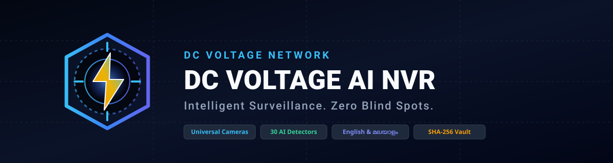
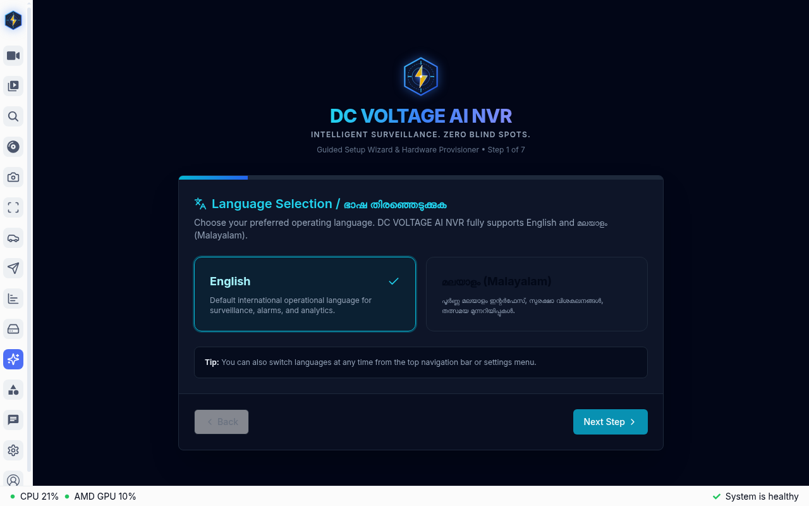
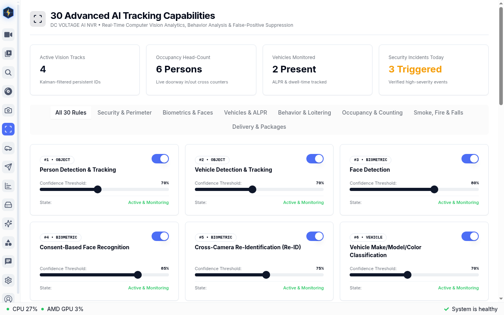

<p align="center">
  
</p>

<p align="center">
  <strong>Intelligent Surveillance. Zero Blind Spots.</strong><br>
  An enterprise-grade, universal AI surveillance and Network Video Recorder (NVR) platform.
</p>

<p align="center">
  <a href="#-quick-start--installation"></a>
  <a href="#-4-optimized-hardware-profiles"></a>
  <a href="#-30-advanced-ai-tracking-capabilities"></a>
  <a href="#-intelligent-bilingual-ai-assistant"></a>
  <a href="#-tamper-evident-evidence-vault"></a>
</p>

---

## 📸 Web Interface Previews

<p align="center">
  <em>Guided Setup Wizard &amp; Advanced AI Tracking Controls (Zero Private Camera Data)</em>
</p>

<p align="center">
  
  
</p>

---

## 🌟 Key Highlights

- **Universal Camera Compatibility:** Native ONVIF Profile S/T/G discovery and RTSP ingestion for Hikvision, Dahua, CP Plus, TP-Link Tapo, Reolink, Imou, EZVIZ, Axis, Uniview, Amcrest, and USB webcams.
- **30 Advanced AI Tracking Capabilities:** Person, vehicle, explicit-consent face recognition, cross-camera Re-ID, ALPR allow/deny list registry, loitering, restricted zone intrusion, fall & rapid downward motion detection, smoke/fire visual hazard detection, and camera tampering alerts.
- **Intelligent Bilingual AI Assistant:** Natural language search and daily security briefings powered by local Ollama, Google Gemini (`gemini-2.5-flash`), OpenAI, or deterministic offline fallback in both **English** and **മലയാളം (Malayalam)**.
- **Telegram Bot Alert Engine:** Instant notifications with high-resolution snapshots, MP4 video clips, camera health status, and bot commands (`/status`, `/snapshot`, `/daily_summary`).
- **Tamper-Evident Evidence Vault:** SHA-256 forensic integrity hashing and digital chain-of-custody verification for court-admissible evidence export.
- **Optimized for Every Machine:** Four tailored hardware profiles ensuring smooth operation on low-power laptops (Profile A) up to multi-GPU enterprise AI clusters (Profile D).

---

## 🚀 Quick Start & Installation

DC VOLTAGE AI NVR includes a turnkey installer that auto-detects system hardware, configures secure credentials, and launches the container stack:

```bash
# 1. Clone the repository
git clone https://github.com/dc-voltage/dcvoltage-ai-nvr.git
cd dcvoltage-ai-nvr

# 2. Run the turnkey installer
chmod +x *.sh
./install.sh
```

Once started, open your web browser to complete the guided onboarding:
👉 **`http://localhost:5000/setup`**

---

## 📊 30 Advanced AI Tracking Capabilities

| # | Capability | Description | Default Status |
|---|---|---|---|
| 1 | **Person Tracking** | Multi-camera tracking with stable track IDs | Enabled |
| 2 | **Vehicle Tracking** | Cars, trucks, buses, motorcycles, bicycles | Enabled |
| 3 | **Face Detection** | Real-time face localization & pose | Enabled |
| 4 | **Face Recognition** | 1:N biometric gallery with explicit consent | Configurable |
| 5 | **Human Re-Identification (Re-ID)** | Cross-camera person tracking across blind spots | Enabled |
| 6 | **Vehicle Zone-to-Zone Tracking** | Transition tracking across defined camera zones | Enabled |
| 7 | **Vehicle Attribute Classification** | Make, body type (sedan/SUV/van), and color | Enabled |
| 8 | **License Plate Recognition (ALPR)** | Plate OCR with Allow List / Deny List | Enabled |
| 9 | **Pet Detection & Tracking** | Dogs, cats, and domestic pets | Enabled |
| 10 | **Animal Classification** | Livestock and wildlife identification | Enabled |
| 11 | **Object Left Behind** | Static unattended item alerts | Enabled |
| 12 | **Object Removed** | Missing asset and theft alerting | Enabled |
| 13 | **Abandoned Luggage** | Stationary unattended bag alerting | Enabled |
| 14 | **Loitering Detection** | Dwell-time monitoring beyond threshold | Enabled |
| 15 | **Restricted Area Intrusion** | Polygonal virtual perimeter alarms | Enabled |
| 16 | **Line-Crossing Detection** | Bi-directional virtual tripwire triggers | Enabled |
| 17 | **Crowd Detection** | Density estimation exceeding threshold | Enabled |
| 18 | **People Counting** | Ingress and egress directional counting | Enabled |
| 19 | **Vehicle Counting** | Parking and transit volume counting | Enabled |
| 20 | **Occupancy Monitoring** | Live area capacity tracking | Enabled |
| 21 | **Unusual Movement** | Erratic trajectory and rapid acceleration | Enabled |
| 22 | **Running & Falling Detection** | Sudden posture collapse and slip detection | Optional |
| 23 | **Smoke & Fire Detection** | Visual combustion and flame flicker alerts | Enabled |
| 24 | **Camera Tampering Detection** | Defocus, spray paint, occlusion, redirection | Enabled |
| 25 | **Suspicious Activity Detection** | Multi-attribute anomalous behavior scoring | Enabled |
| 26 | **After-Hours Activity Detection** | Time-scheduled movement alerts during curfew | Enabled |
| 27 | **Delivery Person Detection** | Uniform/carrier identification (courier/postal) | Enabled |
| 28 | **Package Detection** | Parcel placement and porch pickup monitoring | Enabled |
| 29 | **Person-Vehicle Association** | Correlates individuals entering/exiting vehicles | Enabled |
| 30 | **Operator Review & Correction** | Human-in-the-loop review for AI classification | Always Active |

---

## ⚡ 4 Optimized Hardware Profiles

| Profile | Hardware Target | RAM | SHM | Primary Detector | Cameras |
|---|---|---|---|---|---|
| **Profile A** | Older PC / Laptop (CPU-Only) | 4–8 GB | 256 MB | CPU (`ai-edge-litert`) | 2–4 |
| **Profile B** | Standard PC (Intel/AMD iGPU) | 8–16 GB | 512 MB | VAAPI / Coral TPU | 4–8 *(Recommended)* |
| **Profile C** | Advanced Server (Dedicated GPU) | 16–32 GB | 1024 MB | NVIDIA TensorRT / CUDA | 8–16 |
| **Profile D** | Enterprise AI Cluster | 32+ GB | 2048 MB | Multi-GPU + Ollama Sidecar | 16–64+ |

---

## 🛠️ Management CLI Utilities

All operational tasks can be managed using the included root automation scripts:

- **System Diagnostic:** `./hardware-detect.sh`
- **Health Verification:** `./healthcheck.sh`
- **Cryptographic Backup:** `./backup.sh`
- **Disaster Recovery Restore:** `./restore.sh --archive backups/<backup_file>.tar.gz`
- **Zero-Downtime Update:** `./update.sh`
- **Clean Uninstallation:** `./uninstall.sh --keep-data`

---

## 📚 Documentation Package

Detailed engineering manuals and technical guides are available in the [`docs/`](docs/) directory:

- 📖 [User Operating Manual](docs/USER_MANUAL.md)
- 🔧 [Troubleshooting & Recovery Guide](docs/TROUBLESHOOTING_GUIDE.md)
- 🔌 [REST API Specification](docs/API_SPECIFICATION.md)
- 📋 [Release Notes v1.0.0](docs/RELEASE_NOTES.md)
- 🔬 [Source Code Analysis](SOURCE_CODE_ANALYSIS.md)
- 🏛️ [Architecture Report](ARCHITECTURE_REPORT.md)
- 🛡️ [Security Audit Report](SECURITY_AUDIT.md)

---

## 📄 Upstream Foundation & Licensing

DC VOLTAGE AI NVR is developed by **DC VOLTAGE NETWORK** using [Frigate 0.18.2](https://github.com/blakeblackshear/frigate) as its baseline foundation under the MIT License. Upstream architecture and licensing requirements are fully preserved.

---
<p align="center">
  <strong>DC VOLTAGE NETWORK</strong><br>
  <em>Intelligent Surveillance. Zero Blind Spots.</em>
</p>
